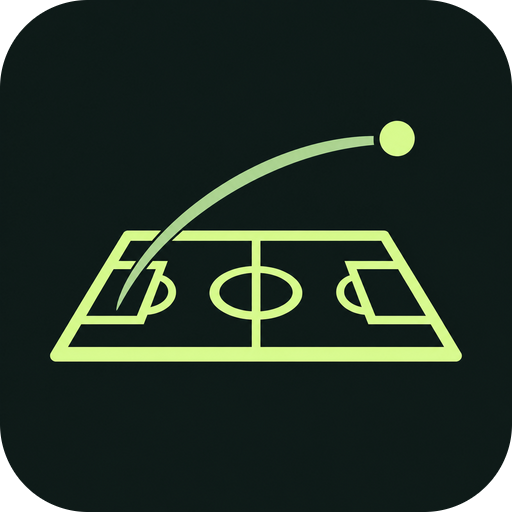
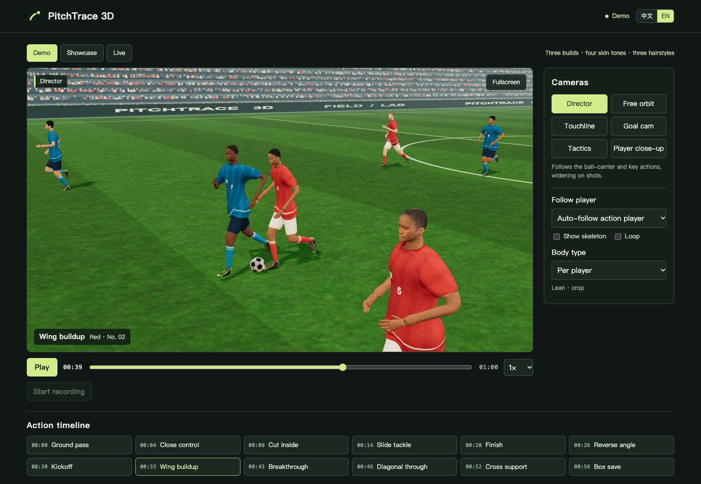
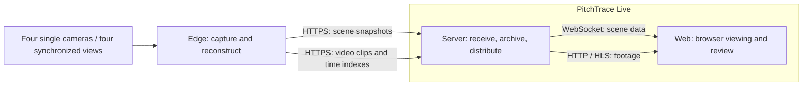
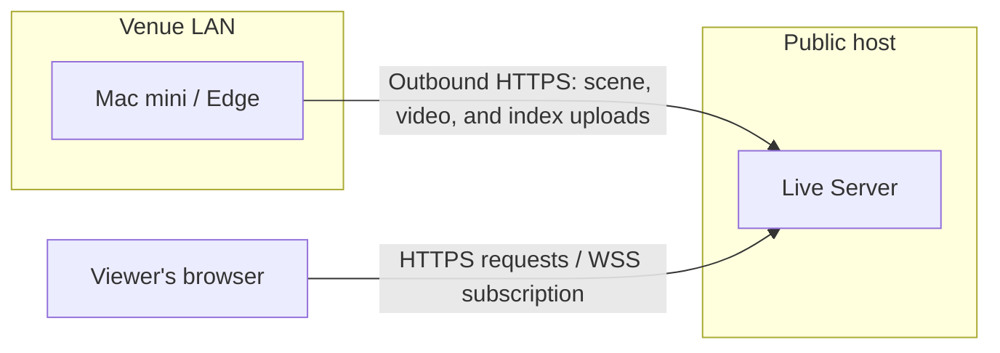

English | **[中文](README.zh-CN.md)**

# <sup></sup> PitchTrace 3D

[](https://github.com/winixi/pitchtrace-3d/actions/workflows/pages.yml)
[](https://github.com/winixi/pitchtrace-3d/releases/latest)
[](https://github.com/winixi/pitchtrace-3d/stargazers)
[](LICENSE)

PitchTrace 3D is a 3D tracking and replay project for football (soccer) matches. The first-phase MVP uses one camera at each of four positions around the pitch. It aims to reconstruct players, the ball, and skeletal motion from synchronized views on an M6 Mac mini, letting viewers freely switch angles to review passes, shots, and challenges.

**[Try the 3D demo](https://winixi.github.io/pitchtrace-3d/)** to watch the built-in 60-second match and explore the player showcase.

[](https://winixi.github.io/pitchtrace-3d/)

The [live viewing frontend](live/web/) can also connect to a WebSocket live data feed and play external HLS footage. After cloning, you can open the [offline viewing page](live/web/dist/index.html) directly in a browser.

## Subprojects and responsibilities

**Edge produces match data; Live Server receives, archives, and distributes it; Live Web presents it to viewers.** There are two independently built and released products: PitchTrace Edge (`edge/`) and PitchTrace Live (`live/`). Live includes a server and a browser frontend. The table below describes responsibilities in the complete system, including planned features; implementation status follows separately.

| Component | Runtime & technology | Responsibility in the complete system |
| --- | --- | --- |
| [PitchTrace Edge](edge/) | Pitch-side Mac mini; Swift/SwiftPM. Planned: Core ML, Vision, C++/OpenCV, FFmpeg, VideoToolbox. | Capture and synchronize four camera views, calibrate cameras, detect and track players and the ball, recognize shirt numbers, reconstruct 3D positions and skeletons, generate action candidates, and save/upload video clips and exposure-time indexes. |
| [Live Server](live/server/) | Mac mini or a separate server. Local gateway uses Node.js, `ws`, and SQLite. The full gateway is planned for TypeScript and Fastify. | Receive and validate Edge uploads, authorize access per match, archive scene data and media, distribute live snapshots, provide historical queries, and publish HLS footage. |
| [Live Web](live/web/) | Viewer's browser; Vite build, Three.js rendering, HLS playback. | Render players and the ball from scene positions and skeletons; provide virtual camera controls, player following, pause/replay, footage comparison, and the manual review interface. |

Camera calibration, recognition, and 3D measurement belong to Edge. Rendering and the six virtual viewpoints belong to Web; the four physical camera views provide the original footage. Server handles data delivery, storage, and access. See the [Edge design](docs/02-technical-design.md#pitchtrace-edge) and [Live design](docs/02-technical-design.md#pitchtrace-live).

### Implementation status

| Component | Implemented now | Planned / not yet implemented |
| --- | --- | --- |
| Edge | Dual-camera recording input, exposure-ordered offline replay, and v2 fMP4 media export. | Live camera capture and synchronization, calibration, inference, tracking and 3D fusion, action generation, and uploads. |
| Live Server | Serves the Web page, the simulated stream, and v1 forwarding. The local v2 gateway archives and publishes scenes, offers paginated history, and archives fMP4 footage with per-frame exposure indexes. | Device and viewer authentication, public streaming, and operational media retention. |
| Live Web | Built-in match, six virtual viewpoints, player following, skeleton display, v1/v2 live scenes, local v2 archive replay, and paused footage review by exposure time. v2 supports an empty pitch, a lost ball, and unknown shirt numbers. | Manual review and corrections. |

The archive viewer can match a paused 3D frame to the selected camera by exposure time. Independent external HLS playback is also available.

### Current runnable data flows

```text
Built-in 60-second match → Web (offline; no Edge or Server required)
External v1 sender → POST /frame → Server → WS /live → Web
v2 fixture or sender → POST /v2/matches/{matchId}/frames → SQLite → per-match WebSocket → Web
Server demo generator → WS /demo → Web
External HLS source → HTTP(S) → Web (independent video playback)
```

The v1 and v2 paths can be exercised with scripts or other data producers. Real-camera capture, reconstruction, and upload from Edge are planned.

### Planned full data flow

The complete pipeline has two outputs from Edge: structured scene snapshots (players, ball, skeletons, and action candidates), and original video clips with exposure-time indexes. The following diagram is the target architecture, not an implemented end-to-end pipeline.



In the planned pipeline, Server archives snapshots before broadcasting them and publishes HLS playlists after receiving the matching clips and indexes. Web uses match IDs and exposure timestamps to align 3D scenes with footage; historical replay queries the server archive.

Edge and Server can run as separate processes on the same Mac mini or on different hosts. Their planned storage is separate, and they exchange data through versioned network interfaces. Server currently serves Web's `dist/index.html`; Web can also be deployed as a static site, and its built-in demo runs offline. See the [scene and media contract](docs/02-technical-design.md#edge-live-contract).

### Public Server + LAN Mac mini Edge (planned)

In this deployment, cameras and Mac mini Edge stay on the venue's private LAN; Live Server runs on a public host. Edge captures and reconstructs locally, and viewers access Server for live scenes, footage, and historical replay. **This is a planned deployment, not a capability of the current sample gateway.**

The arrows below show **which side initiates each connection**, rather than the direction of every data message. Server responses and live pushes travel back over the established connections.



- **Edge → Server:** Edge initiates outbound HTTPS requests using the configured public server address and device credentials. It uploads scene snapshots, video clips, and exposure-time indexes. The Mac mini needs outbound access to Server; it needs no public IP address or inbound port forwarding. Camera access stays within the venue LAN.
- **Browser → Server:** The browser initiates HTTPS requests for the page, footage, and history, and a WSS connection for scene subscriptions. Server pushes scene snapshots over that browser-initiated connection. Viewers access the public service without connecting to Edge.
- **Access control (planned):** Server checks a device's permission to write to a match separately from a viewer's permission to read it.

**Network outage and recovery (planned):**

1. If the venue uplink fails or Server becomes unavailable, Edge continues local capture, recording, and reconstruction. It persists scene snapshots, video clips, indexes, and pending-upload records; upload failures do not block capture. Public viewers cannot receive new venue data during the outage, and the viewing page indicates the interruption.
2. After reconnecting, Edge sends the current snapshot first and resumes live uploads, then uses available bandwidth to backfill historical snapshots, video clips, and indexes. Live data takes priority over the backlog.
3. Server handles retries idempotently using scene frame keys and stable media paths. Backfilled old frames enter the archive without moving live viewers backward in time; media segments join HLS playlists only after the matching files and indexes are complete.

The local gateway defaults to `127.0.0.1` and supports v2 archival, idempotency, and browser reconnection. Edge upload queues, automatic backfill, and public HTTPS/WSS access with device and viewer authorization are planned.

## Project documentation

| Document | Purpose |
| --- | --- |
| [Detailed requirements](docs/01-requirements.md) | Defines the match flow, feature scope, and on-site acceptance criteria. |
| [Technical design](docs/02-technical-design.md) | Designs the four-channel capture, Mac mini 3D reconstruction, data distribution, and review pipeline. |
| [Development plan](docs/03-development-plan.md) | Schedules site surveys, development, live-shoot acceptance, and release; names owners and release conditions per stage. |
| [MVP hardware selection](docs/05-hardware-selection.md) | Compares Mac mini configurations and sizes the network and removable storage for four cameras. |
| [Real-time reconstruction assessment](docs/06-real-time-reconstruction-assessment.md) | Evaluates the five-layer proposal, the two-camera field trial, and the 100–200 ms latency target. |

## Repository structure

```
pitchtrace-3d/
├── docs/                      Requirements, technical design, and development plan
├── edge/                      PitchTrace Edge · pitch-side edge compute (Swift / SwiftPM)
│   ├── Package.swift
│   └── Sources/PitchTraceEdge/
└── live/                      PitchTrace Live · live and viewing
    ├── web/                   Browser viewing frontend (Vite + Three.js)
    │   ├── src/               app / match / receiver / live-frame / pitch / rig / media / protocol
    │   ├── test/              Built-in match and protocol cases (node:test)
    │   └── dist/index.html    Build output, openable offline
    └── server/                Local playback gateway (v1/v2, Node.js)
        ├── server.mjs         Source
        └── server.cjs         Bundled output
```

For each subproject, see [edge/README.md](edge/README.md), [live/web/README.md](live/web/README.md), and [live/server/README.md](live/server/README.md); for AI-agent guidance, see [AGENTS.md](AGENTS.md).

## Build & test

Requires Swift 6.0+ for Edge and Node.js 22.13+ for the local v2 gateway. The Web build also supports Node.js 20.19+ on the Node 20 line. The commands below run from the repository root.

```sh
# Edge · build and test
swift build --package-path edge
swift test --package-path edge --disable-xctest

# Live Web · develop, test, and build the single-file frontend
cd live/web && npm ci && npm run dev      # dev server
cd live/web && npm test                   # checks the built-in match and data protocol
cd live/web && npm run build              # generates dist/index.html

# Live Server · build and start the playback gateway
cd live/server && npm ci && npm test && npm run build
node live/server/server.cjs               # listens on 127.0.0.1:8766
```

## Local playback

To play back a WebSocket data stream, first run `npm run build` in `live/web`, then from the repository root run the following command and open <http://127.0.0.1:8766/>. The v1 demo also runs on Node.js 20.19+.

```sh
node live/server/server.cjs
```

It listens on `127.0.0.1:8766` by default. On a trusted LAN you can set `PITCHTRACE_HOST` and `PITCHTRACE_PORT` to the Mac's LAN IP and port; viewers open the page at the corresponding address. For camera controls, data-frame format, and how to rebuild the gateway, see the [viewing frontend guide](live/web/README.md) and the [gateway interface guide](live/server/README.md).

Open [trial-01](http://127.0.0.1:8766/?match=trial-01) to subscribe to the local v2 stream. Submit fixtures and select **Archive replay** to watch them again. [Sample commands](live/server/README.md#v2-本地场景联调) · [Archive replay](live/server/README.md#v2-历史查询与回放)

The [two-camera sample](live/server/README.md#v2-原片归档与同步复核) generates footage and verifies switching cameras while the 3D replay is paused.

## License

Original code is released under the [MIT License](LICENSE). Third-party models, animations, and dependencies used by the demo retain their own licenses; see [asset attribution & licenses](live/web/licenses/).
