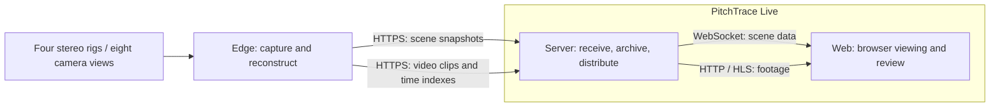

English | **[中文](README.zh-CN.md)**

# PitchTrace 3D

PitchTrace 3D is a 3D tracking and replay project for football (soccer) matches. It aims to capture the action with four stereo camera rigs around the pitch and reconstruct players, the ball, and skeletal motion on Mac mini edge nodes, letting viewers freely switch angles to review passes, shots, and challenges.

The [live viewing frontend](live/web/) is runnable. It ships with a built-in 60-second match and can also switch to a WebSocket live data feed and external HLS footage. After cloning, you can open the [offline viewing page](live/web/dist/index.html) directly in a browser.

## Subprojects and responsibilities

**Edge produces match data; Live Server receives, archives, and distributes it; Live Web presents it to viewers.** There are two independently built and released products: PitchTrace Edge (`edge/`) and PitchTrace Live (`live/`). Live includes a server and a browser frontend. The table below describes responsibilities in the complete system, including planned features; implementation status follows separately.

| Component | Runtime & technology | Responsibility in the complete system |
| --- | --- | --- |
| [PitchTrace Edge](edge/) | Pitch-side Mac mini; Swift/SwiftPM. Planned: Core ML, Vision, C++/OpenCV, FFmpeg, VideoToolbox. | Capture and synchronize eight camera views, calibrate cameras, detect and track players and the ball, recognize shirt numbers, reconstruct 3D positions and skeletons, generate action candidates, and save/upload video clips and exposure-time indexes. |
| [Live Server](live/server/) | Mac mini or a separate server; currently Node.js and `ws`. Planned: TypeScript, Fastify, SQLite. | Receive and validate Edge uploads, authorize access per match, archive scene data and media, distribute live snapshots, provide historical queries, and publish HLS footage. |
| [Live Web](live/web/) | Viewer's browser; Vite build, Three.js rendering, HLS playback. | Render players and the ball from scene positions and skeletons; provide virtual camera controls, player following, pause/replay, footage comparison, and the manual review interface. |

Camera calibration, recognition, and 3D measurement belong to Edge. Rendering and the six virtual viewpoints belong to Web; the eight physical camera views provide the original footage. Server handles data delivery, storage, and access. See the [Edge design](docs/02-technical-design.md#pitchtrace-edge) and [Live design](docs/02-technical-design.md#pitchtrace-live).

### Implementation status

| Component | Implemented now | Planned / not yet implemented |
| --- | --- | --- |
| Edge | Buildable SwiftPM executable skeleton with an empty entry point; it exits immediately when run. | Camera capture and synchronization, calibration, inference, tracking and 3D fusion, action generation, video production, and uploads. |
| Live Server | Serves the built Web page; validates v1 snapshots at `POST /frame` and forwards them through `WS /live`; generates a simulated stream at about 20 Hz through `WS /demo`. Keeps only the latest received frame in memory. | Full v2 gateway, per-match isolation and authentication, persistent archives and historical queries, video/index ingestion, HLS publishing, and exposure-time footage lookup. |
| Live Web | Built-in 60-second match, six virtual viewpoints, player following, skeleton display, live-frame freezing and return to live, reconnection, v1/v2 scene input, and independent playback of an external HLS source. v2 supports an empty pitch, a lost ball, and unknown shirt numbers. | Real-match historical replay backed by server archives, exposure-time synchronized footage review, and manual review/editing. |

**Web's v2 input support does not make the sample server a v2 gateway.** HLS playback currently uses an external source with independent controls; synchronized 3D/footage replay is planned.

### Current runnable data flows

```text
Built-in 60-second match → Web (offline; no Edge or Server required)
External v1 sender → POST /frame → Server → WS /live → Web
Server demo generator → WS /demo → Web
External HLS source → HTTP(S) → Web (independent video playback)
```

The external v1 sender can be a script or another data producer. The repository's Edge executable does not yet produce or send match data, so the real-camera-to-Edge-to-Web pipeline is not operational yet.

### Planned full data flow

The complete pipeline has two outputs from Edge: structured scene snapshots (players, ball, skeletons, and action candidates), and original video clips with exposure-time indexes. The following diagram is the target architecture, not an implemented end-to-end pipeline.



In the planned pipeline, Server archives snapshots before broadcasting them and publishes HLS playlists after receiving the matching clips and indexes. Web uses match IDs and exposure timestamps to align 3D scenes with footage; historical replay queries the server archive.

Edge and Server can run as separate processes on the same Mac mini or on different hosts. Their planned storage is separate, and they exchange data through versioned network interfaces. Server currently serves Web's `dist/index.html`; Web can also be deployed as a static site, and its built-in demo runs offline. See the [scene and media contract](docs/02-technical-design.md#edge-live-contract).

## Project documentation

| Document | Purpose |
| --- | --- |
| [Detailed requirements](docs/01-requirements.md) | Defines the match flow, feature scope, and on-site acceptance criteria. |
| [Technical design](docs/02-technical-design.md) | Designs the eight-channel capture, Mac mini 3D reconstruction, data distribution, and review pipeline. |
| [Development plan](docs/03-development-plan.md) | Schedules site surveys, development, live-shoot acceptance, and release; names owners and release conditions per stage. |

## Repository structure

```
pitchtrace-3d/
├── docs/                      Requirements, technical design, and development plan
├── edge/                      PitchTrace Edge · pitch-side edge compute (Swift / SwiftPM)
│   ├── Package.swift
│   └── Sources/PitchTraceEdge/
└── live/                      PitchTrace Live · live and viewing
    ├── web/                   Browser viewing frontend (Vite + Three.js)
    │   ├── src/               app / match / receiver / live-frame / pitch / rig / media / protocol
    │   ├── test/              Built-in match and protocol cases (node:test)
    │   └── dist/index.html    Build output, openable offline
    └── server/                Local playback gateway (v1, Node.js)
        ├── server.mjs         Source
        └── server.cjs         Bundled output
```

For each subproject, see [edge/README.md](edge/README.md), [live/web/README.md](live/web/README.md), and [live/server/README.md](live/server/README.md); for AI-agent guidance, see [AGENTS.md](AGENTS.md).

## Build & test

Requires Swift 6.0+ and Node.js 20.19+ (or 22.12+). The commands below run from the repository root.

```sh
# Edge · build (currently an empty entry skeleton, exits immediately when run)
swift build --package-path edge
swift run  --package-path edge pitchtrace-edge

# Live Web · develop, test, and build the single-file frontend
cd live/web && npm ci && npm run dev      # dev server
cd live/web && npm test                   # checks the built-in match and data protocol
cd live/web && npm run build              # generates dist/index.html

# Live Server · build and start the playback gateway
cd live/server && npm ci && npm run build # bundles server.mjs into server.cjs
node live/server/server.cjs               # listens on 127.0.0.1:8766
```

## Local playback

To play back a WebSocket data stream, first run `npm run build` in `live/web`, then from the repository root run the following command and open <http://127.0.0.1:8766/>. Running the service requires Node.js 20 or higher.

```sh
node live/server/server.cjs
```

It listens on `127.0.0.1:8766` by default. On a trusted LAN you can set `PITCHTRACE_HOST` and `PITCHTRACE_PORT` to the Mac's LAN IP and port; viewers open the page at the corresponding address. For camera controls, data-frame format, and how to rebuild the gateway, see the [viewing frontend guide](live/web/README.md) and the [gateway interface guide](live/server/README.md).

## License

Original code is released under the [MIT License](LICENSE). Third-party models, animations, and dependencies used by the demo retain their own licenses; see [asset attribution & licenses](live/web/licenses/).
