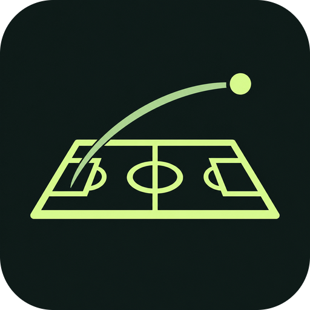
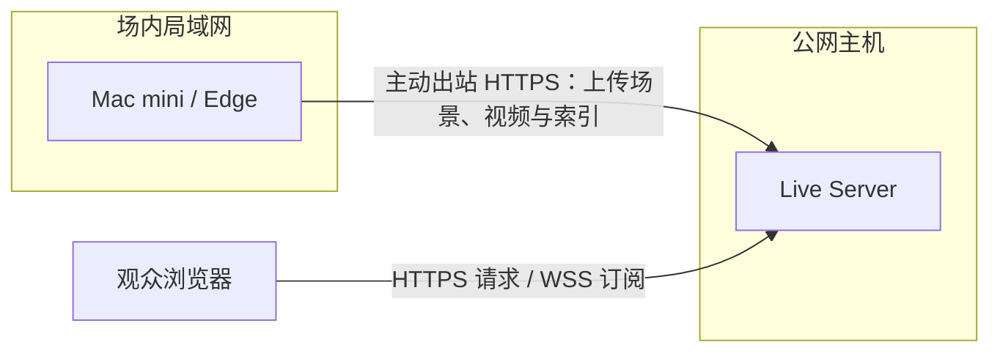

**[English](README.md)** | 中文

#  场迹 · PitchTrace 3D

场迹是一个面向足球比赛的三维跟踪与回放项目。第一阶段 MVP 在球场四周各设一台单摄像头，共四个机位，计划在 M6 Mac mini 上利用同步画面重建球员、足球和骨骼动作，让观众自由切换视角回看传球、射门和拼抢。

**[在线体验 3D 演示](https://winixi.github.io/pitchtrace-3d/)**，观看内置的 60 秒比赛和人物展示。

[直播观赛前端](live/web/) 也支持连接 WebSocket 直播数据和播放外部 HLS 实拍视频。克隆仓库后可直接用浏览器打开[离线观赛页](live/web/dist/index.html)。

## 子项目与职责分工

**Edge 生产比赛数据，Live Server 接收、归档和分发，Live Web 向观众呈现。** 项目包含两个独立构建和发布的产品：PitchTrace Edge（`edge/`）和 PitchTrace Live（`live/`）。Live 内含服务端和浏览器前端。下表说明完整系统中的职责，包含规划功能；实际实现状态在后文单独列出。

| 组成部分 | 运行位置与技术 | 完整系统中的职责 |
| --- | --- | --- |
| [PitchTrace Edge](edge/) | 场边 Mac mini；Swift/SwiftPM。规划采用 Core ML、Vision、C++/OpenCV、FFmpeg、VideoToolbox。 | 接入并同步四路相机、完成标定，检测和追踪球员与足球、识别球衣号、重建三维位置和骨骼、生成动作候选，保存并上传视频片段与曝光时间索引。 |
| [Live Server](live/server/) | Mac mini 或独立服务器；当前为 Node.js 和 `ws`。规划采用 TypeScript、Fastify、SQLite。 | 接收并校验 Edge 上传，按比赛管理访问权限，归档场景与媒体，分发直播快照，提供历史查询，发布 HLS 实拍视频。 |
| [Live Web](live/web/) | 观众的浏览器；Vite 构建、Three.js 渲染、HLS 播放。 | 根据场景位置和骨骼绘制球员与足球，提供虚拟机位切换、跟随球员、暂停回看、实拍对照和人工复核界面。 |

相机标定、识别与三维测量归 Edge；画面渲染与六个虚拟机位归 Web，四个实体相机视角提供原始实拍。Server 负责数据交付、存储与访问管理。详见[边缘端设计](docs/02-technical-design.md#pitchtrace-edge)与[直播端设计](docs/02-technical-design.md#pitchtrace-live)。

### 实现状态

| 组成部分 | 当前已实现 | 规划中／尚未实现 |
| --- | --- | --- |
| Edge | 可构建的 SwiftPM 可执行项目骨架；入口为空，运行后立即退出。 | 相机采集与对时、标定、推理、追踪与三维融合、动作生成、视频生产和上传。 |
| Live Server | 提供构建后的网页；通过 `POST /frame` 校验 v1 快照并经 `WS /live` 转发；通过 `WS /demo` 生成约 20 Hz 的模拟流。仅在内存保留最新接收帧。 | 正式 v2 网关、按比赛隔离与鉴权、持久化归档与历史查询、视频及索引接入、HLS 发布、按曝光时刻定位原片。 |
| Live Web | 内置 60 秒比赛、六个虚拟机位、跟随球员、骨骼显示、直播定格与返回直播、断线重连、v1/v2 场景输入，以及独立播放外部 HLS 视频。v2 支持空场、丢球和未知球衣号。 | 依托服务端归档的真实比赛历史回看、按曝光时刻同步实拍复核、人工审核与修订。 |

**Web 支持 v2 输入，不代表示例 Server 已支持 v2 网关。** 当前 HLS 播放使用外部视频源和独立控件；三维与实拍同步回看仍在规划中。

### 当前可运行的数据流

```text
内置 60 秒比赛 → Web（可离线运行，无需 Edge 或 Server）
外部 v1 发送程序 → POST /frame → Server → WS /live → Web
Server 模拟数据生成器 → WS /demo → Web
外部 HLS 视频源 → HTTP(S) → Web（独立播放视频）
```

外部 v1 发送程序可以是脚本或其他数据生产端。仓库中的 Edge 可执行程序尚不能生产或发送比赛数据，因此真实相机经 Edge 到网页的链路尚未打通。

### 规划中的完整数据流

完整链路包含 Edge 的两类输出：结构化场景快照（球员、足球、骨骼和动作候选），以及带曝光时间索引的原始视频片段。下图是目标架构，尚未形成端到端实现。


规划中，Server 先归档快照再广播，收到匹配的视频片段和索引后才发布 HLS 播放列表。Web 通过比赛 ID 与曝光时间戳对齐三维场景和实拍，历史回看从服务端归档查询。

Edge 和 Server 可以作为独立进程同驻一台 Mac mini，也可以分别部署。规划中两端各自存储，通过版本化网络接口交换数据。Server 当前提供 Web 的 `dist/index.html`；Web 也可独立部署到静态站点，内置演示可以离线运行。详见[场景与媒体契约](docs/02-technical-design.md#edge-live-contract)。

### 公网 Server + 局域网 Mac mini Edge（规划中）

这种部署将摄像头和 Mac mini Edge 留在场内局域网，Live Server 部署在公网主机。Edge 在本地采集与重建，观众通过 Server 观看三维直播、实拍与历史回看。**这是规划中的部署方式，当前示例网关尚不具备完整能力。**

下图箭头表示**哪一端主动发起连接**，并非每条数据消息的流向。Server 的响应与直播推送沿已建立的连接返回。



- **Edge → Server：** Edge 使用配置的公网服务地址和设备凭据，主动发起出站 HTTPS 请求，上传场景快照、视频片段与曝光时间索引。Mac mini 只需具备访问 Server 的出站能力，无需公网 IP 或入站端口映射；相机接入留在场内局域网。
- **浏览器 → Server：** 浏览器主动发起 HTTPS 请求获取网页、实拍与历史数据，并建立 WSS 连接订阅场景。Server 沿浏览器发起的连接推送快照。观众访问公网服务，无需连接 Edge。
- **访问控制（规划中）：** Server 分别校验设备对比赛的写入权限，以及观众对比赛的读取权限。

**断网与恢复（规划中）：**

1. 场内外网中断或 Server 不可用时，Edge 继续在本地采集、录像与重建，持久化场景快照、视频片段、索引及待上传记录；上传失败不阻塞采集。断网期间公网观众无法收到新的现场数据，观赛页面标明数据中断。
2. 重连后，Edge 先发送当前快照并恢复实时上传，再按可用带宽补传历史快照、视频片段与索引；实时数据优先于历史积压。
3. Server 按场景帧键和稳定媒体路径对重试做幂等处理。补传旧帧进入归档，不回退观众的直播时钟；媒体文件与对应索引齐备后，片段才加入 HLS 播放列表。

**实现边界：** 浏览器 WebSocket 断线重连已实现。Edge 上传、待上传记录持久化、自动重试与补传、带设备／观众鉴权的公网 HTTPS/WSS 接入，以及服务端 v2 归档与幂等处理仍在规划中。当前 v1 网关默认监听 `127.0.0.1`，用于本地或可信局域网试播，没有鉴权与持久化归档；仅修改监听地址尚不能实现上述公网部署。

## 项目文档

| 文档 | 用途 |
| --- | --- |
| [详细需求说明](docs/01-requirements.md) | 确定比赛流程、功能范围及现场验收标准。 |
| [技术实现方案](docs/02-technical-design.md) | 设计四路采集、Mac mini 三维重建、数据分发及复核链路。 |
| [落地开发计划](docs/03-development-plan.md) | 安排场勘、开发、实拍验收与发布，明确各阶段负责人和放行条件。 |
| [MVP 硬件选型](docs/05-hardware-selection.md) | 选择 Mac mini、统一内存和可换录像盘，估算四路相机的带宽与存储。 |

## 仓库结构

```
pitchtrace-3d/
├── docs/                      需求、技术方案与开发计划
├── edge/                      PitchTrace Edge · 场边边缘计算（Swift / SwiftPM）
│   ├── Package.swift
│   └── Sources/PitchTraceEdge/
└── live/                      PitchTrace Live · 直播与观赛
    ├── web/                   浏览器观赛前端（Vite + Three.js）
    │   ├── src/               app / match / receiver / live-frame / pitch / rig / media / protocol
    │   ├── test/              内置比赛与协议用例（node:test）
    │   └── dist/index.html    构建产物，可离线打开
    └── server/                本地试播网关（v1，Node.js）
        ├── server.mjs         源码
        └── server.cjs         打包产物
```

各子项目的说明见 [edge/README.md](edge/README.md)、[live/web/README.md](live/web/README.md) 和 [live/server/README.md](live/server/README.md)；给 AI 代理的工作指引见 [AGENTS.md](AGENTS.md)。

## 构建与测试

需要 Swift 6.0+ 和 Node.js 20.19+（或 22.12+）。下列命令从仓库根目录运行。

```sh
# Edge · 构建（当前为空入口骨架，运行后立即退出）
swift build --package-path edge
swift run  --package-path edge pitchtrace-edge

# Live Web · 开发、测试与构建单文件前端
cd live/web && npm ci && npm run dev      # 开发服务器
cd live/web && npm test                   # 检查内置比赛与数据协议
cd live/web && npm run build              # 生成 dist/index.html

# Live Server · 构建并启动试播网关
cd live/server && npm ci && npm run build # 把 server.mjs 打包成 server.cjs
node live/server/server.cjs               # 监听 127.0.0.1:8766
```

## 本地试播

要试播 WebSocket 数据流，先在 `live/web` 执行 `npm run build`，再从仓库根目录运行以下命令，然后打开 <http://127.0.0.1:8766/>。运行服务需要 Node.js 20 或更高版本。

```sh
node live/server/server.cjs
```

默认监听 `127.0.0.1:8766`。可信局域网内可用 `PITCHTRACE_HOST`、`PITCHTRACE_PORT` 指定 Mac 的局域网 IP 与端口，观众用对应地址打开页面。机位操作、数据帧格式和重新构建网关的说明见[观赛前端说明](live/web/README.md)和[网关接口说明](live/server/README.md)。

## 许可证

原创代码采用 [MIT 许可证](LICENSE)。演示使用的第三方模型、动画和依赖保留各自许可，详见[素材署名与许可](live/web/licenses/)。
