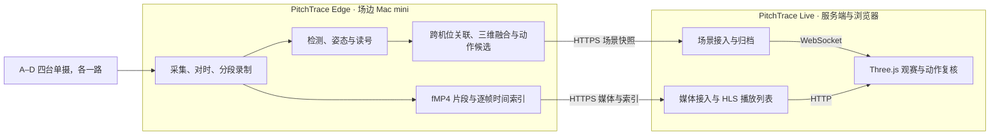
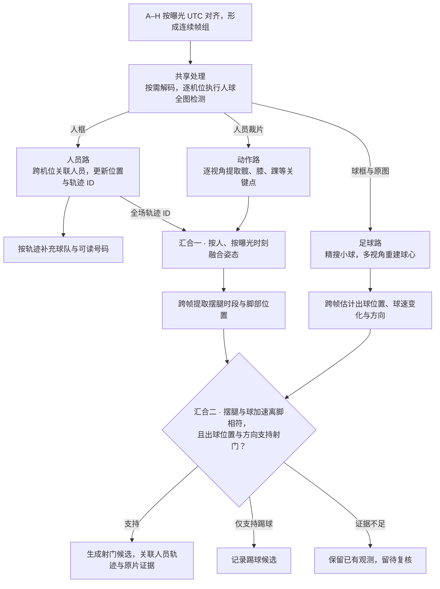

# 场迹 · 技术实现方案

第一阶段 MVP 采用四台单摄像头、一台 M6 Mac mini 和浏览器观赛端。首轮实测要确认远端的球和号码能否拍清，验证四个机位的曝光时刻是否对齐，并测量 Mac mini 能否长期跟上输入速率。建议的分辨率与推理频率均为测试起点。功能和精度门槛以[详细需求说明](01-requirements.md)为准。

## 1. 系统与模块边界

同一仓库规划两个独立构建、测试和发布的产品。**PitchTrace Edge** 从实拍画面生产比赛数据和视频片段。**PitchTrace Live** 接收两类数据，为观众及复核员提供直播与回看。首场试点两个进程可同驻一台 Mac mini，接口也支持把直播服务部署到另一台主机。直播前端已有内置演示、v1/v2 场景订阅、归档回放和按曝光时刻复核原片。试播网关支持 v2 场景和原片的本地归档。Edge 支持 2–4 机位离线录像输入，实时采集与重建待开发。[直播前端](../live/web/) · [试播网关](../live/server/)



| 模块 | 部署与实现建议 | 输入 → 输出／责任 |
| --- | --- | --- |
| 设备、比赛、标定（R01、R03） | Mac mini 上的配置服务，SQLite 保存版本和状态；OpenCV 负责几何计算 | 相机序号、镜头参数、测量点 → 场地模型、内外参、误差、有效起止时刻。 |
| 采集与原片（R02、R10） | 按设备选 GigE/USB 厂商 SDK 或 RTSP 客户端。按通道独立采集，原码分段落盘；编码流可用 VideoToolbox 解码 | 曝光时间与码流 → 可重放的原片、帧号索引、统一时钟映射。 |
| 单视角视觉（R04、R05、R06） | 第一版用 Python/OpenCV 跑录像基线，目标机用可转换为 Core ML 的模型比较精度和耗时 | 图像 → 人、球、关键点、号码候选及置信度，全部带机位与时间。 |
| 三维融合与动作（R04–R07） | Mac mini，先实现可离线复算的几何与时序处理器，再对接实时窗口 | 多视角观测、标定、名单 → 稳定轨迹 ID、球心三维位置、骨骼、事件与证据。 |
| 分发与观看（R07、R08、R09、R10） | 场景快照经 WebSocket 发布；原片按比赛时间索引为 HLS 或本地分段文件；浏览器用 Three.js 绘制 | 结构化状态和原片是两种输出。六个虚拟机位在浏览器生成，四个实拍视角用于核验。 |
| 运行与复盘（R10、R11、R12） | 本机监督进程、磁盘配额、比赛归档和角色权限 | 设备健康、时延、版本、人工更正 → 告警、重放、审计与导出。 |

<a name="pitchtrace-edge"></a>

### 1.1 边缘计算子项目 · PitchTrace Edge

**目录与交付物。** SwiftPM 程序 `pitchtrace-edge` 支持 2–4 机位离线录像输入。用 ffprobe 读取 H.264/fMP4 的帧时序，再根据 PTS 匹配采集端提供的曝光 UTC。逐段归并帧记录，导出原始媒体、v2 索引和缺口报告。操作员可按机位提交媒体，也可用共同闪光的帧标注生成对时报告。后续将程序连同模型版本清单、设备配置和标定文件部署到场边。[Edge 录像输入与联调](../edge/README.md)

| 实现单元 | 首版技术选择 | 输入、处理和输出 |
| --- | --- | --- |
| 采集与视频 | Swift、厂商 SDK 或 AVFoundation、FFmpeg 的 libavformat、Apple VideoToolbox | 工业相机通过厂商 SDK 读取帧和硬件时钟；macOS 可识别的摄像头可用 AVFoundation；网络机型用 libavformat 接入 RTSP。能取得曝光时间且满足同步门槛的通道才参与精确三维融合。对 H.264 兼容输入直接重新封装，其他输入按需解码并编码为 H.264。输出可独立寻址的 fMP4 初始化文件、关键帧对齐的媒体段及曝光时间索引。[Apple 视频采集](https://developer.apple.com/documentation/avfoundation/avcapturevideodataoutput) · [FFmpeg 封装格式](https://ffmpeg.org/ffmpeg-formats.html) |
| 检测与推理 | Swift 调用 Core ML 和 Vision；Python/OpenCV 用于离线标注检查、模型对照与误差评估 | 人、球检测先跑轻量 Core ML 模型；在球员裁切上用 Vision 建立姿态和背号 OCR 基线。按时刻、相机、局部轨迹记录观测。Python 产出的基准样例与线上重复输入比较。 |
| 标定与融合 | C++/OpenCV `calib3d`，通过窄 C 接口供 Swift 调用 | 保存内外参及版本，先按同一曝光窗口组帧，再做跨视角分配、三角化、重投影检查和时序滤波。输出场地坐标、来源机位和质量；局部骨骼重定向后再进入场景快照。 |
| 调度与持久化 | Swift Concurrency、有界队列、SQLite、文件系统、URLSession | 每路采集独立排队。录像与推理分开消费；记录队列中最老帧的年龄。视频先落盘，场景帧与待上传条目持久化后发送。直播端宕机时保留采集，重连先发当前快照，再按带宽补历史。 |

边缘侧拥有设备配置、时钟映射、标定和测量结果。模型、校正参数或推理频率改变时记录对应版本。动作候选随轨迹生成；操作者在直播端的人工修订另存，归档重算时保留修订历史。现场设备型号及检测器权重在 G1 实测后锁定。

<a name="pitchtrace-live"></a>

### 1.2 直播子项目 · PitchTrace Live

**目录与交付物。** `live/web/` 已构建浏览器静态文件，复用原演示的 JavaScript 渲染器并使用 Vite 打包。`live/server/` 提供当前的 v1 试播网关，正式 v2 网关仍在规划中。两者随同一直播版本交付。输入可以来自 Mac mini，也可以来自协议样例或一场归档比赛，便于在没有相机时独立开发。

| 实现单元 | 首版技术选择 | 路径与行为 |
| --- | --- | --- |
| 写入、鉴权、归档 | Node.js LTS、TypeScript、Fastify、JSON Schema、SQLite 与文件存储 | HTTP 接口校验比赛权限、字段和帧键。场景记录先写入归档，再发 WebSocket 并应答。SQLite 索引比赛、场景序号、媒体区间和复核修订；二进制媒体以文件形式流式写入。[Fastify 请求校验](https://fastify.dev/docs/latest/Reference/Validation-and-Serialization/) |
| 三维直播 | Fastify 的 `@fastify/websocket` 插件，底层使用 `ws` | 订阅者按比赛隔离。连接后先发最新快照，再发后续帧；慢客户端跳过旧快照。暂停观看时记录比赛时刻，回看从归档接口补帧，返回直播时重新定位。[Fastify WebSocket 插件](https://github.com/fastify/fastify-websocket) |
| 实拍直播与回看 | HLS、H.264/fMP4、浏览器原生 HLS 或 hls.js | 接收边缘侧已封装的片段，完成校验和提交后发布播放列表。网页为选中的实拍机位打开对应 HLS，原生支持时直接播放，其余支持 MSE 的浏览器使用 hls.js。换机位按曝光时刻重新定位，保留同一比赛时刻。[hls.js 项目文档](https://github.com/video-dev/hls.js) |
| 观赛与复核页面 | TypeScript、Vite、Three.js、OrbitControls | 用场景帧驱动播放器与时间轴，共用比赛时钟同步球员蒙皮、选定球员、六个三维机位和实拍对照。复用演示中已验证的机位及骨骼逻辑，为正式页面补齐缺测、历史查询和人工复核。 |

<a name="edge-live-contract"></a>

### 1.3 两端交付协议

场景和媒体索引的 JSON Schema 位于 `schemas/v2/`。契约由两个子项目共同版本化。边缘与直播各自维护 SQLite，所有路径以 `/v2/matches/{matchId}` 为前缀。本地网关支持场景和媒体归档。摄像头通道重连且媒体时钟重置时，生产端更新 `{mediaEpoch}`。Edge 离线重放支持同一机位的多个媒体周期。原帧以机位、媒体周期、片段号和 PTS 标识，跨周期的回放与定位统一使用曝光 UTC。[双机位时钟重置样例](../edge/README.md#模拟-a-路时钟重置)

| 发送方 → 接收方 | 方法与相对路径 | 数据与完成条件 |
| --- | --- | --- |
| Edge → Live | `POST /frames`（本地已实现） | 写入完整场景快照，见第 6 节。以 `(matchId,streamEpoch,seq)` 去重。同键同内容重试成功，同键异内容返回 409。 |
| Edge → Live | `PUT /cameras/{cameraId}/epochs/{mediaEpoch}/init.mp4` 和 `PUT /cameras/{cameraId}/epochs/{mediaEpoch}/segments/{n}.m4s` | 上传初始化文件和第 n 个媒体段；服务端核对大小、摘要并原子提交。网络中断可按同一路径重传。 |
| Edge → Live | `PUT /cameras/{cameraId}/epochs/{mediaEpoch}/segments/{n}/index` | 发送媒体段摘要、时基、逐帧 PTS 与曝光 UTC 映射。初始化文件、媒体段和索引全部匹配后，Live 才将该段加入播放列表；缺件可补传。 |
| Live → 浏览器 | `WS /live`、`GET /frames?fromMs=…&toMs=…`（本地已实现） | 直播推完整快照。回看按比赛时段分页拉取归档。公网按比赛授权读取仍在规划。 |
| Live → 浏览器 | `GET /cameras/{cameraId}/index.m3u8` 及受控片段读取 | 发送实拍视频。网页通过 `GET /cameras/{cameraId}/locate?captureUtcUs=…` 查询片段号、媒体 epoch、目标 PTS 和时基，定位到触球附近。机位缺片时标明缺口，其他机位和三维画面继续。 |

比赛创建时由 Live 分配比赛 ID，场务把相同 ID、场地和名单版本配置给 Edge。Edge 通过配置取得网关地址与设备凭据，网关校验设备是否可写入该比赛。场景使用 `streamEpoch`、媒体使用各通道的 `mediaEpoch`；两类数据通过比赛 ID 和曝光 UTC 对齐。

**联调样例。** 录制一次 7 号球员传球，同时保留两个机位的实拍。Edge 输出带比赛 ID、曝光时刻和序号的快照以及两个机位的片段。Live 在同一时刻展示三维脚部与球，并能切到两个原片视角核对。测试中重复上传同一段、打断一次上传、重启一次网关，核对快照和媒体均只归档一次。先用固定样例验协议，再用现场录像验证时钟、精度与 5 分钟端到端期限。

## 2. 现场输入、视频传输和对时

1. **选位。** 每个支架安装一台相机，以 A–D 标识四路视频、曝光索引和标定记录。测量安装坐标、高度、朝向与焦距。在场地图上按网格统计各格看到的独立机位数、夹角、球直径像素和号码高度像素。重点检查远端禁区、中线、角旗与常见争抢区。先用一个球和一名带号码的运动员走位，再决定镜头和安装点。
2. **接入。** 每台相机输出一路，输入适配层按相机 ID 保留原帧号与曝光时间戳。以 1080p、25/30 fps 为基线；快速飞球另测 50/60 fps 与短曝光。选择接口前确认目标 macOS 的 SDK、实际模式下的帧率、曝光时间戳及重连行为。
3. **同步。** 四台相机采用同一触发源，或使用 PTP 对时结合定时曝光。仅收到相近的网络包不能证明曝光同步。记录设备时钟、频率、漂移、时钟重置和曝光中心。用各机位可见的同步闪光复测。普通 RTSP 机型若无法证明曝光时间，标记为低精度输入，并单独检验其对飞球的影响。具有相应功能的 GigE 相机可用 PTP 和计划动作协调采集。[Basler 定时动作说明](https://docs.baslerweb.com/scheduled-action-commands)
4. **录制与复播。** 厂商 SDK 帧可在采集节点编码，已有压缩流可直接分段封装。建议每段约 2 秒、关键帧对齐，保存曝光时间到媒体 PTS 的映射。已完成段原子提交后再加入索引。直播与录像回放共用同一帧结构；复核端按目标时间从前一个关键帧解码到指定帧。Mac 平台的硬件编解码能力通过真实并发测试确认。[Apple VideoToolbox](https://developer.apple.com/documentation/videotoolbox)

**容量估算。** 四路各 8 Mbit/s 的压缩输入合计 32 Mbit/s，约 14.4 GB/小时，90 分钟约 21.6 GB，均未计索引、副本与封装开销。相同四路若传 1080p30、每像素 1.5 字节的未压缩图像，约需 373 MB/s，即 2.99 Gbit/s。场勘要确认编码位置、交换机上联和 Mac 网口；同一套设备的两种传输方式对带宽要求相差很大。按实测峰值码率、录像场次和留存天数计算 SSD 容量，并预留写入余量。

## 3. 标定与三维轨迹

- **标定流程。** 分别估计四台相机的内参与畸变，用实测场地标记和已知高度的标杆求取各机位相对同一球场坐标系的外参。保留未参与拟合的地面点和高点，独立检验三维误差。相机位姿、分辨率、焦距和镜头更换均产生新版本。可用 OpenCV 的相机标定、PnP、三角化和重投影函数实现。[OpenCV 相机标定与三维重建](https://docs.opencv.org/4.x/d9/d0c/group__calib3d.html)
- **远距离可行性。** 针孔近似下物体像素高度约为 `f × H / Z`。以 `f=1800 px`、球直径 0.22 m、距离 70 m 为例，球宽仅约 5.7 px。远端高球和离地关节的三维测量需要至少两个已标定、同步且夹角合适的机位看清同一目标。用已知高度的目标检查误差，并按网格记录双视角可见率。只有一个机位时可将清晰的落地足点投影到场地平面，离地目标保留二维观测并标记三维缺测。
- **单视角检测。** 首轮候选为 YOLO11n 检测版，导出 Core ML 模型，保留“人”和“运动用球”两类检测框与置信度。人员框用于提取队服颜色、建立局部轨迹和裁切人体。每个观测记录模糊程度与遮挡比例，模型清单记录权重来源、版本、许可及输入预处理。[Ultralytics Core ML 导出说明](https://docs.ultralytics.com/integrations/coreml/)
- **远端小球。** 全图检测负责发现新目标，同时从原始分辨率画面裁出球的预测区域，复用同一检测器精搜。以上述 5.7 px 的球为例，整帧从 1920 px 宽缩到 640 px 后球宽仅约 1.9 px。丢球时扩大搜索范围，并保留周期性全图搜索。若人工在原片也难以辨球，先调整焦距或机位；若清晰裁片仍频繁漏球，再用本场足球、球鞋、白线和广告板等正负样本评估专用球检测器。
- **多人关联。** 先用时间、极线距离、地面位置、运动速度筛掉不合理组合，再以队服、稳定号码和短时外观特征构造代价矩阵。首版可用卡尔曼滤波预测位置、匈牙利算法匹配观测；保留未匹配集合，避免强行配对。利用重投影残差剔除异常机位。交叉跑位保留多个短时候选；阈值不足时延后绑定。全场轨迹 ID 与各镜头的局部 ID 独立。身份合并、更正和换人生成版本记录。
- **人员与球。** 球员足点可在已知地面上投影，腾空关节、头和球使用多视角射线三角化；以重投影误差、夹角、时间差与观测数量评价质量。球分为滚动、飞行、可能触球与丢失状态。使用短窗口平滑；触球或折返处分段，以免把真实变向抹掉。只有单视角时可提供二维证据；飞球深度约束不足则标记缺测。所有预测设有效期限，试点起始值 0.3 秒，超期隐藏并保留轨迹断点。

## 4. 号码、骨骼、动作与复核

**球衣和名单。** 仅在躯干朝向合适、号码像素充足时做文字识别，结合队伍和连续多帧投票。号码冲突或置信度不足保留候选；需要同队唯一匹配或人工确认后才关联名单 ID。选中场次、有权限的名单字段才能显示。球员性别字段来自报名或授权记录，模型外形由用户另选。更改显示属性无需重新计算几何轨迹。

macOS 首轮在单人裁片上调用 Vision 的 `VNDetectHumanBodyPoseRequest` 估计二维关节，在清晰的背号裁片上调用 `VNRecognizeTextRequest` 读号。号码经多帧投票稳定后，降低该轨迹的读号频率。用快速转身、球衣折叠和斜视样本评估两项基线，再决定是否引入专项模型。[Apple 人体姿态请求](https://developer.apple.com/documentation/vision/vndetecthumanbodyposerequest) · [Apple 文字识别请求](https://developer.apple.com/documentation/vision/vnrecognizetextrequest)

**骨骼。** 在人框中估计 2D 关键点，按同一轨迹、同一时刻融合。对双侧髋、肩、膝、踝等关节分别计算可见性和三维误差；约束骨长与关节范围，保存原始测量及平滑结果。重定向时按绑定姿态和父骨骼坐标求局部四元数，映射到基础模型。单段骨骼的轴向扭转可能不可观测，应降低该自由度的可信度。每种模型测跑动、摆腿、转头和铲球姿态，检查颈肩连续性、左右脚与地面接触。

| 事件 | 初版可解释的证据 | 复核重点 |
| --- | --- | --- |
| 传球 | 控球者脚附近球加速离开，之后在另一队友脚附近再次受控 | 区分折射、抢断和传球失败；记录发起人及可能接球人。 |
| 踢球／射门 | 脚部摆动与球速变化对齐，方向和位置支持射向球门时产生射门候选 | 长传、解围和射门可能相似，允许人工更改标签。 |
| 带球／过人 | 球多次随同一球员推进；与防守者相对位置变化后攻击者仍控制球 | 快速跑位或对手让位可能产生误报，回看前后各数秒。 |
| 铲球／疑似接触 | 人体重心下降、腿伸展、与球或对手的距离骤减 | 同步列出各机位的首次触球、可能接触帧及误差；不足以确认先后的保留未决。 |

事件输出包含开始／结束、参与者、置信度、证据机位、原片定位和人工结论。评分时将漏检与误报分别统计；复核员的犯规判定单独存储。

### 4.1 Edge 三路分析如何生成射门候选

下图采用比赛日脚本中的八机位扩展方案。Edge 当前支持 2–4 机位离线录像与对时，四机位实拍是 MVP 基线，八机位持续吞吐仍待实测。[比赛日脚本](../assets/youtube/matchday-walkthrough-v3/八机位产品介绍片-审阅脚本.txt) · [Edge 实现状态](../edge/README.md)



- **共享帧和检测结果。** 在同一次分析中，每个入选的机位帧只解码一次、做一次全图检测。三路复用帧和检测框，可同时进行人员关联、单视角姿态估计和小球精搜。曝光窗口截止时，用已对齐的有效机位继续，记录缺失机位。录像按采集帧率独立落盘。
- **第一次汇合确定谁在摆腿。** 人员路把各机位的人框关联到同一全场轨迹后，动作路就能把对应的关键点归到同一人名下，融合同一曝光窗口内可见的关节，沿连续帧提取摆腿。球衣号可在清晰时补到轨迹上，两队同号或号码未知时仍按轨迹 ID 关联动作。
- **第二次汇合判断这脚球是否构成射门候选。** 在同一场比赛内，按曝光时间将摆腿时段与球速变化对齐，在标定后的球场坐标系中核对球是否从该球员脚边加速离开，以及出球位置和方向是否支持射向球门。证据充分即可生成候选，无须等球落地。若飞球只剩一个有效视角，保留二维观测并标记三维缺测。触球窗口截止时证据仍不足，则保留未决，人员与球的已有结果照常输出。

## 5. 边缘节点资源与 5 分钟延迟预算

### 5.1 Mac mini 的推理调度与能耗验证

方案以 M6 Mac mini 为目标配置，M4／24 GB 可作为首场试点候选机，按相同输入与期限验证持续吞吐和能耗。以下模型与频率是待验证的起点。实际承载人数、骨骼更新率和每场耗电量均待目标机实测。采购建议与录像盘容量见[MVP 硬件选型](05-hardware-selection.md)。

1. **按曝光时刻调度。** 四路原片按 25/30 fps 录制，参与融合的视角在同一曝光窗口取帧。全图检测从每路 10 Hz 起步，合计每秒 40 次，另计小球裁片和姿态请求。全员保留基础姿态更新，持球人、拼抢双方和关键动作窗口优先加密，选用同步且遮挡少的视角。离线高精度复算使用低优先级队列。
2. **在候选主机上选择计算单元。** YOLO11n 先导出为固定输入尺寸、FP16 的 `.mlpackage`，用同一批标注画面对照转换前后的检测结果，单列远端小球召回率。在 Swift 中将 `MLModelConfiguration` 实例的 `computeUnits` 设为 `.all` 起测，在 Xcode 的模型 Performance 页与 `.cpuAndNeuralEngine`、`.cpuAndGPU` 比较预测耗时和各算子实际使用的计算单元。将候选配置放回四路流程复测，计入解码、缩放、裁切和排队耗时。[Apple 计算单元配置](https://developer.apple.com/documentation/coreml/mlcomputeunits) · [Apple 模型性能分析](https://developer.apple.com/documentation/coreml/analyzing-a-core-ml-model-s-performance-in-xcode)
3. **逐项测量每场耗电。** 以相同的四路录像、目标人数和原速回放，依次测人球检测、加入姿态、再加入读号后的负载。候选整机配置各跑满 90 分钟，用插座功率计记录主机耗电量（Wh/场）和平均功率（W）。记录芯片、统一内存、模型版本、输入格式和接入的外设，分环节报告吞吐、最老待处理帧的年龄、峰值内存及热机前后的变化。
4. **按质量和连续性选配置。** 比较远端球召回率、关节误差与覆盖率、读号准确率。完整链路按场景发布 10 Hz、曝光后 300 秒内首次绘制的预期输出时隙占比 ≥99% 验证，记录实测 P95、缺帧和队列积压。在达到约定质量和连续性门槛的配置中，优先选每场耗电较低者。录像回放与现场端到端结果分别记录。[试点验收口径](01-requirements.md)

### 5.2 端到端延迟预算

| 环节 | 正常负载下的初始估算 |
| --- | ---: |
| 曝光、传输、解码、对齐 | 2 s |
| 检测、关键点和号码推理，含队列 | 7 s |
| 跨机位融合和未来帧观察窗口 | 8 s |
| 事件生成、序列化和发布 | 3 s |
| 网络、浏览器缓冲与首次绘制 | 2 s |
| 正常负载估算合计 | 22 s |

上表用于初测和定位瓶颈。按 22 秒估算，距 300 秒端到端期限尚有 278 秒，供短时推理积压和耗时波动共享。调度器按每帧的曝光时间加 300 秒计算显示期限，预留后续融合、传输和绘制耗时。积压的输入可按已落盘的视频段和帧索引排队，只在处理时解码，控制统一内存占用。客户端与采集时钟经校准后按帧关联，在浏览器绘制时记录时间；赛前以同屏拍摄现场闪灯与显示屏核对计量误差。队列按比赛时间设置上限，记录预测完成时间；预算紧张时先降低 OCR 和远离球的姿态频率，再降低次要视角检测频率。持续过载则发布明确的降级或缺测状态、保存原片，赛后补算。延时缓冲只能吸收短时波动；长期有效吞吐须达到输入速率。

## 6. 数据契约、分发和故障恢复

**现有 v1 兼容。** `POST /frame` 接收完整 JSON 快照，`/live` WebSocket 向浏览器转发，`/demo` 生产约 20 Hz 的模拟数据；浏览器做约 100 ms 的插值。v1 要求 1–32 个球员、每人有整数号码，且每帧都有球坐标，骨骼可选。这些约束无法完整表示真实场地的未知号码、空场或丢球。保留 v1 回归样例及观赛前端的内置演示入口。[现有校验器](../live/web/src/protocol.js) · [接收端](../live/web/src/receiver.js)

**本地 v2。** 发布器向 `POST /v2/matches/{matchId}/frames` 提交场景快照，浏览器订阅 `/v2/matches/{matchId}/live`。一帧可含零个球员，球、号码和关节观测可缺失。当前本地实现沿用 Node.js HTTP 与 `ws`，使用内置 SQLite 保存快照和直播游标。[场景 JSON Schema](../schemas/v2/scene-frame.schema.json) · [试播步骤](../live/server/README.md#v2-本地场景联调)

```json
{
  "v": 2,
  "matchId": "trial-01",
  "streamEpoch": "period-1-a",
  "seq": 251,
  "captureUtcUs": "1795494600000000",
  "matchTimeMs": 25000,
  "calibrationId": "field-a-v3",
  "players": [
    {"trackId":"p17","teamId":"home","rosterId":null,"number":null,
     "positionM":[12.4,0,-3.1],"yawRad":0.8,"state":"measured",
     "views":["A","C"],"confidence":0.89,"bones":{}}
  ],
  "ball":{"state":"lost","positionM":null,"views":[]},
  "events":[]
}
```

- 帧键为 `(matchId,streamEpoch,seq)`。内容比较忽略 JSON 空白和对象字段顺序，保留数组元素顺序。同键同内容返回 202，同键异内容返回 409。
- 归档与直播游标在同一事务提交，成功后才确认或转发。同周期的直播帧要求序号增加、比赛时间持平或前进；切换至新周期要求比赛时间前进。已退出的周期和较早的帧只归档。网关重启后恢复游标，新订阅和重连先收到已提交的最新直播帧。慢客户端发送过程中只保留一个待发最新帧。
- `captureUtcUs` 为非负的 UTC Unix 微秒十进制字符串，`calibrationId` 为标定版本标识，两者在写入时必填。位置采用 `[X,Y,Z]` 米，关节旋转采用绑定骨架局部 `[x,y,z,w]`。球字段可为 `null`；`lost` 位置可为 `null` 或省略，`measured / predicted` 需要坐标。轨迹 ID 在单帧内唯一，四元数额外校验归一化。复核事件的稳定 ID 与修订号随复核功能实现。
- 只有号码、球等字段均已知且满足 v1 约束的帧可通过兼容适配器发布到 v1。其余情况由 v2 直接展示；避免用 0 号或球场原点填补未知观测。正式观赛端需支持真实比赛回看、失球标记、按时刻选择原片及断线恢复。
- 实拍归档按比赛和机位提供 HLS 播放列表及分段。浏览器暂停三维回放后请求选中机位的目标 PTS，播放对应的单段 HLS 列表并停在目标帧。拖动和换机位按当前三维快照的曝光 UTC 定位。
- 采集端与写入 API 使用设备凭据，观看、修改、下载原片分权；跨设备部署使用加密传输。用于本地开发的演示网关默认监听回环地址。网关以比赛隔离订阅，慢客户端可跳到最新快照，归档写入单独排队。

### v2 场景历史与回放

- `GET /v2/matches/{matchId}/frames` 以 `fromMs`、`toMs` 指定比赛毫秒闭区间，单次跨度最多 60,000 ms。省略两者时取截至最新归档时刻的 30,000 ms。响应包含整场 `bounds`、本次 `range`、`frames` 和 `nextCursor`。空库的默认查询返回空数组和 `null` 范围。
- 以 `(matchTimeMs, streamEpoch, seq)` 升序分页，同时间先按周期标识再按序号排序。使用服务器返回的 `nextCursor` 续页，保留首次查询所见的归档范围与数据。并行补传在重新查询后纳入结果。每页默认 100 帧，最多 200 帧，快照载荷约 1 MB 时提前分页。
- 同源观赛页按比赛时间播放归档快照，切换虚拟机位保持暂停时刻。同一时刻存在多帧时，界面显示该时刻排序最后的一帧。离最近快照达到 1 秒时显示缺帧提示。直播 WebSocket 继续接收数据，退出回放后显示最新帧。[本地回放步骤](../live/server/README.md#v2-历史查询与回放)

### v2 原片归档与曝光定位

- 初始化文件与片段用二进制 `PUT` 上传，并通过 `X-Content-SHA256` 校验请求体。原字节先写临时文件，完成后以摘要为文件名提交。SQLite 记录比赛、机位、媒体 epoch、片段号和索引。每个段的三件齐备且匹配后才可用于查询和播放。相同路径同内容重传幂等，交叉摘要或大小冲突返回 409。
- 曝光索引每行使用 `captureUtcUs` 表示 UTC Unix 微秒，`pts` 和 `durationPts` 使用声明的有理数时基。曝光严格递增，展示区间依 PTS 排序并互不重叠。首行对应可独立解码片段的首个展示帧。SQLite 媒体 UTC 的范围为非负有符号 64 位整数，接口以十进制字符串传输。
- `locate` 在该比赛和机位内选择最近的已发布帧，容差为该帧时长的一半并向上取整到微秒。无合格帧时返回 404。响应返回请求与命中的曝光、带符号误差、PTS 和时基。单段 HLS 时间轴以片段首帧为零，浏览器 seek 到目标帧展示区间中点以稳定停帧。每次只读取所选机位的目标片段。[曝光索引 Schema](../schemas/v2/media-index.schema.json) · [两路样例](../live/server/README.md#v2-原片归档与同步复核)

### 固定协议回归样例

Edge 和 Live 共用以下 JSON 文件。单帧文件可直接读取为场景快照，时钟重置样例按数组顺序逐帧送入接收器。

| 样例 | 预期 |
| --- | --- |
| [v1 演示帧](../schemas/v1/examples/demo-frame.json) | 取自内置比赛第 12.4 秒，可通过 v1 校验并渲染。 |
| [v2 空场](../schemas/v2/examples/empty-pitch.json) | 球员列表为空，球坐标缺失。 |
| [v2 丢球](../schemas/v2/examples/lost-ball.json) | 场上球员仍可见，球状态为 `lost`，坐标为 `null`。 |
| [v2 未知号码](../schemas/v2/examples/unknown-number.json) | 保留球员轨迹和 `null` 号码，隐藏失去观测的轨迹，保留球的预测坐标。 |
| [v2 时钟重置](../schemas/v2/examples/clock-reset.json) | 同一比赛切换到新 `streamEpoch`，序号从 `0` 开始，比赛时间继续前进。直播清空旧周期的插值缓冲，忽略随后到达的旧周期帧。 |
| [v2 重复轨迹负例](../schemas/v2/examples/invalid/duplicate-track.json) | 同帧存在重复轨迹 ID，网关返回 422，前端也拒绝该帧。 |

## 7. 存储、可观测性与复现

Edge 保存采集原件、标定和待补传记录；Live 保存接收副本、查询索引及人工审核版本。按比赛保存 `manifest`、通道分段视频与校验值、曝光时间索引、标定与模型版本、观测、场景帧、事件及审核记录。试点可用 SQLite 管理索引、文件系统保存媒体与分块轨迹；分段先写临时文件、校验后改名，再事务更新索引。重启扫描孤立段和缺失索引，保留已发布序号、时间缺口及人工修改。删除比赛按配置清理原片、缓存、索引和对应副本并记录结果。

现场面板按通道展示帧率、曝光偏差、接收丢帧、解码队列；按比赛展示推理速度、有效相机数、可见球覆盖、身份切换、低可信对象、延迟分位数、失败时隙和磁盘可用时长。故障注入至少覆盖四路中断开一路、机位移动、时钟跳变、磁盘写满、网关重启及观众断线。对同一归档按固定配置重放，比较时间、轨迹与事件，并记录允许的浮点误差。每项试点门槛的负责人和输出物见[落地开发计划](03-development-plan.md)。
