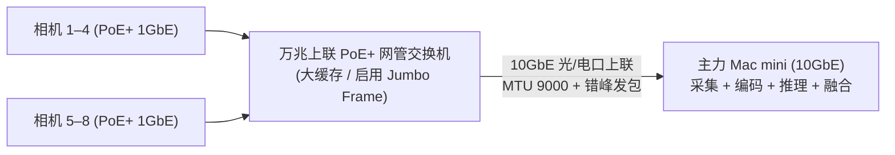
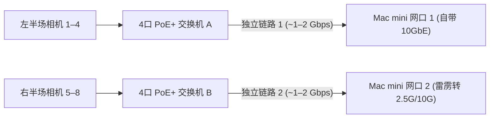
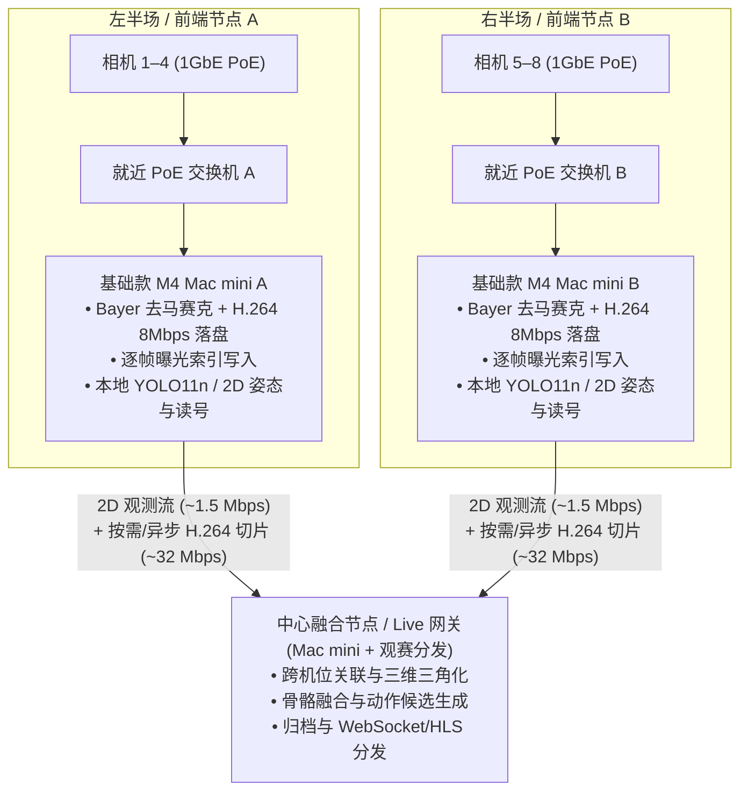

# 八机位 MV-CS050-10GC-PRO 硬件架构优化方案

本文档针对场迹（PitchTrace 3D）从 2–4 台起步扩展到 **8 台海康机器人 MV-CS050-10GC-PRO 同步摄像头**时，单台 Mac mini 集中接入面临的网络高带宽、同步微突发与计算并发瓶颈，提供渐进式的硬件与网络架构优化方案。相机基础参数与双机试点基线见 [MVP 硬件选型](05-hardware-selection.md) 与 [技术实现方案](02-technical-design.md)。

---

## 1. 瓶颈分析：为什么不能简单“8 路直连一台 Mac mini”

按 [技术实现方案 §2.1](02-technical-design.md#21-海康机器人-mv-cs050-10gc-pro-双机采集) 的基线参数，8 台相机集中传输给单台主机时，压力来自三个方面：

### 1.1 原始图像带宽估算

| 采集模式 | 分辨率与格式 | 帧率 | 单路净带宽 | 8 路净带宽 | 计入封包/重传峰值 |
| --- | --- | ---: | ---: | ---: | ---: |
| 试点 ROI 基线 | 1920 × 1080，Bayer RG 8 | 30 fps | 0.498 Gbps | **3.98 Gbps** | 约 4.3–4.6 Gbps |
| 高帧率飞球模式 | 1920 × 1080，Bayer RG 8 | 50 fps | 0.830 Gbps | **6.64 Gbps** | 约 7.2–7.5 Gbps |
| 传感器全幅 | 2448 × 2048，Bayer RG 8 | 24.2 fps | 0.971 Gbps | **7.77 Gbps** | 超出普通万兆实测有效吞吐 |

> 即使在最低的 1080p30 基线下，8 路未压缩流也已远超 2.5GbE 上联极限；若开启全幅或更高帧率，单根 10GbE 链路也会吃紧。

### 1.2 同步曝光导致的瞬时微突发（Micro-burst）

系统要求各机位曝光偏差 **P95 ≤ 5 ms**，无论是通过 PTP `Scheduled Action Command` 还是 `Line 0` 共用外触发，**8 台相机会在同一毫秒完成曝光并几乎同时发出 GigE Vision UDP 帧突发**。这会导致：
- 交换机上联口在数毫秒内承受接近 8 Gbps 的瞬时流量冲击，缓存不足时直接丢包；
- Mac mini 单网卡在短时间内收到海量 UDP 小包（若未开启巨型帧），引发内核中断风暴与接收缓冲区溢出。

### 1.3 单机并发编解码与推理压力

MV-CS050-10GC-PRO 输出原始 Bayer 图像（无 H.264/RTSP 输出），单台 Mac mini 需同时承担：
- **8 路持续去马赛克（Demosaic）与 VideoToolbox H.264 硬件编码**（原始图像流入约 498 MB/s，8 路合计）；
- **8 路 H.264 fMP4 分段与逐帧曝光索引落盘**；
- **8 路目标检测（YOLO11n 80+ Hz 总推理次数）、小球精搜、Vision 姿态估计与读号 OCR**；
- **跨机位关联、三维三角化、动作候选生成与本地服务**。

---

## 2. 四种渐进式硬件架构方案

### 方案一：单机万兆上联 + 协议与参数减负（改动最小）

保留“1 台主力 Mac mini”的单机软件架构，通过升级链路规格与调整 GigE Vision 传输参数来消化 8 路流量。

**关键配置项：**
1. **主机与交换机升级**：Mac mini 选配 **10GbE 万兆网口**（或通过雷雳口外接 10GbE 网卡）；交换机选用带 **10G SFP+ 上联口** 且具备 **大端口缓存（建议 ≥ 1.5–4 MB）** 的网管型 PoE+ 交换机。
2. **开启相机端图像无损压缩**：利用 MV-CS050-10GC-PRO 内置的图像压缩功能（HB/无损压缩），在球场实拍画面下通常可减少 **30%–50%** 传输量，将 8 路 1080p30 净流量压低至 **2.0–2.8 Gbps**。
3. **全链路巨型帧（Jumbo Frames）**：相机、交换机、Mac mini 万兆口统一将 MTU 设为 `9000`，显著降低包数量与系统中断开销。
4. **错峰发包（Inter-Packet Delay / `GevSCPD`）**：保持 8 台相机**曝光时刻严格同步**，但通过设置不同的发包延迟（Packet Delay）与包间间隔，使 8 路图像数据在 `33.3 ms` 的帧周期内错开送达 Mac mini，削平瞬时微突发。

- **适用阶段**：2–4 机位试点向 8 机位初期过渡，不想拆分单机软件架构的验证阶段。
- **局限**：8 路并发编码和推理仍集中在单台 Mac mini，高密度拼抢场景需实测内存带宽、热节流与队列延迟。

---

### 方案二：双链路分区汇聚（物理隔离流量与简化布线）

不增加计算主机，将 8 台相机按球场左右半场（或前后场）拆成两组，分别经独立交换机接入 Mac mini 的两个物理网口。

**关键配置项：**
- 交换机 A/B 就近放在球场两侧看台或支架旁，相机用短网线接入；仅需两条独立长距离链路（光纤或 Cat6A）回传至工作位 Mac mini。
- 两组链路划分独立子网/VLAN，避免跨组广播和组播互相干扰；PTP 主时钟若跨交换机同步，需确保两台交换机间有稳定低抖动的 PTP 转发路径，或采用统一的 `Line 0` 硬件外触发信号。

- **适用阶段**：球场跨度大、不方便把 8 根 30–80 米长网线全部拉回同一工作位的临时架设场景。

---

### 方案三：分布式边缘架构——前端轻采集盒 + 中心融合节点（推荐 8 机位正式部署）

利用 `PitchTrace Edge` 本身“采集/编码/单视角观测”与“跨机位融合/三维重建”天然解耦的特性，将原始 GigE 图像消化在相机附近，主干网络不再传输未压缩图像。

**核心分工与带宽收益：**
1. **前端采集推理节点（2 台基础款 M4 Mac mini，或 4 台每台带 2 路）**：
   - 就近通过短网线接 2–4 台相机，单台机器只需承受 `1–2 Gbps` 原始图像流；
   - 本地完成 Bayer 解码、VideoToolbox **8 Mbps H.264 fMP4 编码落盘** 与曝光索引生成（见 [schemas/v2/media-index.schema.json](../schemas/v2/media-index.schema.json)）；
   - 本地运行单视角 **YOLO11n 人球检测、2D 关节姿态与背号识别**，输出轻量级结构化 2D 观测结果（检测框、关键点、队服特征、号码候选、曝光 UTC）。
2. **中心融合节点（1 台 Mac mini）**：
   - **不再接收 ~4 Gbps 原始 Bayer 图像**；
   - **实时上行仅接收 2D 观测流**：8 路合计约 **1–3 Mbps**；
   - **视频流按需/异步回传**：8 路 8 Mbps H.264 切片合计仅 **64 Mbps**（相比原始流下降 **98% 以上**），甚至在仅做三维直播时只传 2D 观测流，人工复核或生成集锦时再按曝光时刻从前端节点拉取对应 2 秒 fMP4 切片。
3. **对现有代码的衔接**：
   - 前端节点可复用现有的采集编码与 `publish-media` 切片上行能力；
   - 中心节点专注消费各机位对齐后的 2D 观测序列，执行现有的跨视角关联、三角化、动作规则引擎与 v2 网关分发。

- **适用阶段**：**8 机位（及更多机位）正式比赛与商业化场边部署**。算力线性扩展，单台节点负载可控，主干网络用普通千兆线、光纤甚至无线网桥均可稳定运行。

---

### 方案四：相机硬件形态替换（未批量采购前的备选路线）

8 路带宽高的根本原因在于 MV-CS050-10GC-PRO 机身内没有 H.264/HEVC 硬件编码器。如果尚未买齐 8 台相机，后续扩充机位时可评估：
- **带机内 H.264/HEVC 硬编码 + IEEE 1588 PTP 对时 + 硬件帧级曝光时间戳** 的工业网络相机或边缘智能相机，在传感器端直接将 `0.5 Gbps/路` 压缩为 `8–10 Mbps/路`（8 路合计约 `64–80 Mbps`）。
- **硬性前提**：严禁直接用无精确曝光时间戳的普通安防 RTSP 相机替代。如 [技术实现方案 §2](02-technical-design.md#2-现场输入视频传输和对时) 所述，无法证明同步曝光时刻的输入会严重破坏高速飞球的三维三角化精度，选型时必须验证其支持 **曝光中心 UTC 与展示帧 PTS 的精确映射**。

---

## 3. 四种方案综合对比

| 维度 | 方案一：单机万兆 + 调优 | 方案二：双链路分区汇聚 | 方案三：分布式边缘架构（推荐） | 方案四：机内编码同步相机 |
| --- | --- | --- | --- | --- |
| **主干网络带宽（1080p30）** | ~2.0–4.5 Gbps（视压缩而定） | 单链路 ~1.0–2.3 Gbps | **~3 Mbps（仅观测） / ~65 Mbps（含全量 H.264）** | ~64–80 Mbps |
| **同步微突发风险** | 中（依赖大缓存与错峰发包） | 低–中（流量一分为二） | **极低**（前端就近消化） | 低（机内缓冲编码） |
| **单台主机算力压力** | 极高（8 路编解码 + 推理 + 融合） | 极高（算力未拆分） | **低–中**（算力按机位水平扩展） | 中（省去去马赛克与编码，仍需 8 路解码推理） |
| **场边长距离布线** | 8 根长网线集中回主机 | 仅需 2 条主干链路 | **最简（仅 2 条千兆/光纤回传）** | 仅需普通千兆 PoE |
| **软件架构改动** | 无（沿用单机 `edge/`） | 无（沿用单机 `edge/`） | 中（需将单视角观测流与中心融合拆分为网络协议） | 低–中（需适配新相机 SDK 与曝光映射） |
| **新增硬件成本** | 万兆网卡 + 万兆上联交换机 | 双 PoE 交换机 + 雷雳网卡 | **多 1–2 台基础款 M4 Mac mini** | 更换相机型号 |

---

## 4. 分阶段落地与核验建议

1. **当前阶段（2–4 台机位试点）**：优先采用 **方案一**（确认万兆上联、开启相机无损压缩、全链路 MTU 9000 与错峰发包），直接跑通现有的单机 `edge/` 流程与共同闪光测试，核验 8 路等比例负载下的实际丢帧率与队列年龄。
2. **扩至 8 台机位正式部署**：建议直接演进到 **方案三（2 台前端采集推理节点 + 1 台中心融合节点）**。具体核验指标沿用 [试点验收口径](01-requirements.md#5-试点验收口径)：
   - **同步精度**：跨 8 机位共同闪光曝光中心偏差 **P95 ≤ 5 ms**；
   - **网络稳定性**：90 分钟持续采集无交换机端口丢包与 GigE 帧重传雪崩；
   - **端到端延迟**：自曝光起计，至少 99% 的场景输出在 **5 分钟** 预算内完成发布，且队列不随比赛时间持续积压。
